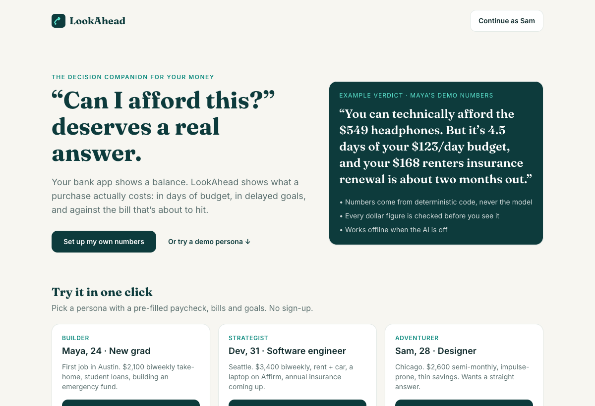
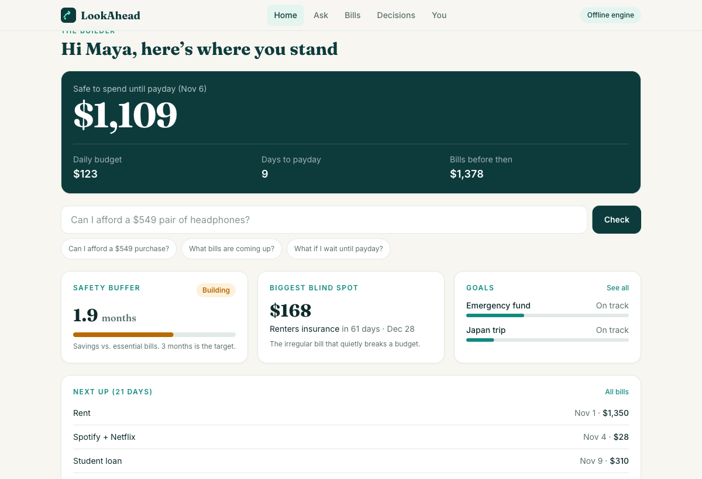
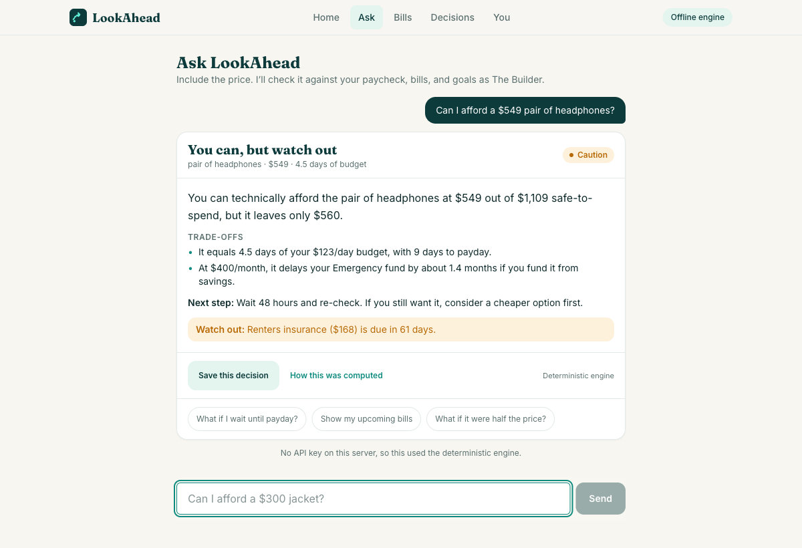

# LookAhead

**A US-market decision companion that answers “Can I afford this?” with your own numbers.**
Instead of a balance, it tells you what a purchase costs in days of budget, in delayed goals, and against the bill that’s about to hit.

Python backend (FastAPI), React frontend, one Docker image.

> **Live demo:** _add your Render URL here after deploying (see [Deploy](#deploy-to-render))_

| | |
|---|---|
|  |  |
|  | |

## The idea in one paragraph

The core design rule: **numbers come from deterministic code; the LLM only classifies intent and explains.**
Safe-to-spend, daily budget, buffer status, goal timelines and the 6-month bill projection are plain Python (`backend/app/core/engine.py`, `obligations.py`). The verdict label itself (`yes` / `caution` / `not_now`) is set by rules in code. The model words the explanation, and its output is rejected if it cites any dollar figure that can’t be traced to the profile or the engine (`grounding.py`). If the AI is off, capped, or fails, the app falls back to a deterministic explanation, so it keeps working.

## What’s in it

- **Onboarding (5 steps)** — avatar (Strategist / Adventurer / Builder), paycheck, balances (incl. savings), bills, goals.
- **Home** — safe-to-spend, daily budget, days to payday, buffer gauge, biggest “blind spot” bill, goals.
- **Ask** — purchase verdicts, profile changes behind a confirmation card (“I paid my rent”, “I got a $1,000 bonus”), follow-up chips, **“How this was computed”** panel showing the 5 context layers, engine numbers and grounding result.
- **Bills** — 6-month projection by month; mark paid and everything recalculates.
- **Decisions** — save a verdict; after 7 days it asks “still holding?”, so you can see whether waiting paid off.
- **You** — computed (not hardcoded) profile and goals, avatar switch, semantic memory you can inspect and delete. Entries older than 90 days stop being used.
- **AI on/off switch** in the header to show the deterministic engine running alone.

US localization: USD, weekly/biweekly/semi-monthly/monthly pay, rent, student loans, car payments, semiannual insurance, credit-card minimums, BNPL (Affirm/Klarna) in place of EMI, emergency-fund-based buffer.

## Architecture

```
React (Vite, TS, Tailwind)  ──/api──▶  FastAPI
                                         ├─ core/engine.py       safe-to-spend, daily budget, buffer, goals   (no LLM)
                                         ├─ core/obligations.py  6-month projection, blind spot               (no LLM)
                                         ├─ core/tools.py        profile mutations + impact preview           (no LLM)
                                         ├─ core/classifier.py   Claude Haiku → rule-based fallback
                                         ├─ core/verdict.py      facts + label in code; Claude Sonnet explains; template fallback
                                         ├─ core/grounding.py    every $ figure in model output must trace to profile/engine
                                         ├─ core/memory.py       dated semantic memory with staleness
                                         ├─ limits.py            per-session + daily LLM caps (public-demo cost guard)
                                         └─ store.py             SQLite: profiles, conversations, saved_decisions
```

## Evaluation (honest numbers)

`cd backend && python -m evals.run_classifier_eval`

- **Labelled set:** 36 queries (7 purchase_check, 17 conversational, 10 tool_call, 2 semantic_update; 8 are deliberately hard edge cases such as hypotheticals and retrospective purchases). Rule-based classifier: **36/36**.
  *Caveat: I wrote the rules and this set together, so that number is optimistic.*
- **Held-out set:** 16 fresh queries written after the rules were tuned. First run: **10/16 (62.5%)**. The misses were real gaps (“Would a $60 sweater put me over budget?”, “Landlord raised my rent to $2,050”, “I overspend whenever I’m stressed”). I fixed those patterns, after which that set is no longer held-out (now 16/16). The honest takeaway: the rules are brittle on unseen phrasing, which is why production routing uses the Haiku classifier with rules as the fallback.
- **Not measured:** accuracy of the live Claude classifier and verdict explanations. This environment had no API key, so the LLM path is covered by tests with mocked model output (hallucinated figure → rejected; grounded output → used) but has **not been run against the real API**. Run `python -m evals.run_classifier_eval --llm` with a key to measure it.

Tests: `cd backend && pytest` (30) and `cd frontend && npm test` (7).

## Run locally

```bash
# backend
cd backend && python3 -m venv .venv && .venv/bin/pip install -r requirements-dev.txt
.venv/bin/uvicorn app.main:app --reload            # http://localhost:8000
# optional, enables the AI path:  export ANTHROPIC_API_KEY=sk-ant-...

# frontend (dev server proxies /api to :8000)
cd frontend && npm install && npm run dev           # http://localhost:5173
```

Or the production image: `docker build -t lookahead . && docker run -p 8000:8000 lookahead`.

Without `ANTHROPIC_API_KEY` the app runs entirely on the deterministic engine.

## Deploy to Render

1. Push this repo to GitHub.
2. Render → **New → Blueprint** → pick the repo (it reads `render.yaml`).
3. In the service’s environment, set `ANTHROPIC_API_KEY`. Leave it unset to run keyless.
4. Optionally tune `LOOKAHEAD_SESSION_CAP` (default 15 AI-backed questions per visitor) and `LOOKAHEAD_DAILY_CAP` (default 300 across all visitors). When a cap is hit the app silently uses the deterministic engine and tells the user.

The free tier sleeps when idle (first load can take ~30s). Models default to `claude-haiku-5-5` (classify) and `claude-sonnet-5-5` (verdicts); override with `LOOKAHEAD_FAST_MODEL` / `LOOKAHEAD_SMART_MODEL`.

## Known limitations

- **Demo storage:** SQLite on ephemeral disk, keyed by an anonymous cookie. Data is purged after 7 days and lost on redeploy. No accounts, no bank connections.
- **No investment, tax or legal advice** — out-of-scope questions get a polite redirect. This is decision support, not financial advice.
- Tool extraction (“I paid my rent”) is rule-based; the LLM only classifies the intent.
- Pay is modeled as take-home per paycheck; no tax calculation.
- Verdict thresholds (over 40% of safe-to-spend, etc.) are reasonable defaults, not validated with users.
- Willingness to pay for this is unproven; there is no monetization in the MVP.
